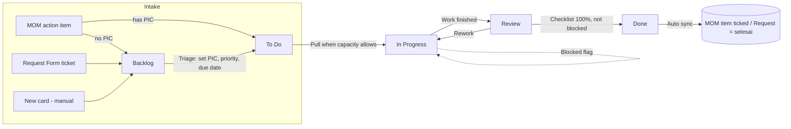

# Project Timeline (Kanban) — End-to-End Flow

Menu: **Operations → Project Timeline** (`/kanban`). Opens on the timeline; the **Board** tab holds the Kanban columns.
Tables: `kanban_tasks`, `kanban_task_activities` (see `supabase/schema.sql` §13).
Rules live in `src/lib/kanban.ts`.

## 1. Flow overview

| Stage | Meaning | Entry rule (Definition of Ready) | WIP limit | Owner |
|---|---|---|---|---|
| Backlog | Ideas, requests, follow-ups not yet prioritised | — | ∞ | Head RG (triage) |
| To Do | Committed for the next cycle | **PIC required** | 15 | PIC |
| In Progress | Actively worked on | PIC required; first entry stamps `started_at` | 8 | PIC |
| Review | Awaiting check by Head RG / requester | PIC required, **not blocked** | 5 | Head RG / requester |
| Done | Approved and closed | **Checklist 100%**, not blocked; stamps `completed_at` | ∞ | — |

WIP limits are soft: a move over the limit is allowed but shows a warning and the column turns amber. That signals the team to finish existing work before pulling more.

## 2. Step-by-step

1. **Intake**
   - *New Card* (header or the `+` on any column) for ad-hoc work.
   - *Pull from MOM / Requests* shows every open MOM action item and every Request Form ticket with status `baru`/`ditugaskan` that is not yet on the board. Duplicates are prevented by the unique index on (`source_type`, `source_id`, `source_ref`).
     - MOM items that already have a PIC land in **To Do**. Items without one land in **Backlog**.
     - Requests land in **Backlog** for triage.
2. **Triage (weekly, Head RG):** in Backlog, set PIC, priority, module, due date and a checklist (the Definition of Done), then move the card to To Do.
3. **Execute:** the PIC drags the card to In Progress.
   - Request-sourced cards set the ticket to `diproses` and fill `assigned_pic`.
   - If something external stalls the work, tick **Blocked** with a reason. The card turns red and is counted in the Blocked KPI.
4. **Review:** the PIC moves the card to Review once the work is done. The reviewer either sends it back to In Progress or moves it to Done.
5. **Close:** moving to Done needs every checklist item ticked. Then:
   - the originating MOM action item is ticked `done`;
   - the originating Request ticket becomes `selesai`.
6. **Archive:** the board shows Done cards from the last 14 days; tick *Show Done > 14 days* to see older ones. Done cards older than 90 days drop out of the board query but stay in the database.

## 3. Audit trail

The database trigger `kanban_tasks_track` writes these automatically, whether a card is moved by drag & drop or through the edit form:
- every stage move (`moved`, from → to, actor = user email);
- blocked / unblocked events;
- card creation (`created`).

Clients can only add `comment` rows (enforced by RLS), so the history cannot be edited from the app. Everything shows on the card's **Activity & Comments** tab.

## 4. Metrics (KPI strip)

| KPI | Definition |
|---|---|
| Open Cards | Cards not in Done |
| WIP | Cards in In Progress + Review |
| Overdue | Open cards with `due_date` before today |
| Blocked | Open cards flagged blocked |
| Done (7 days) | Throughput: cards with `completed_at` in the last 7 days |
| Avg Cycle Time (30d) | Mean of `completed_at − started_at` for cards finished in the last 30 days |

## 5. Suggested cadence

- **Daily stand-up (15 min):** walk the board right to left (Review → In Progress), then blockers and overdue cards.
- **Weekly triage (Head RG):** empty Backlog into To Do, run *Pull from MOM / Requests*, and check that WIP limits still fit team size.
- **Monthly:** review the cycle-time trend in the Weekly Report.

## 6. Projects & timeline

Group cards into **projects** (an initiative with an owner, module, start and end date) and follow them on **Project Timeline → Timeline**. Table: `kanban_projects`; cards link through `kanban_tasks.project_id` (see `supabase/migrations/20261026_kanban_projects.sql`, ADR-005). Rules live in `src/lib/kanban-projects.ts`.

- **Create** with *New project* on the timeline. Add cards to it from the card dialog's **Project** field. When the board is filtered to a project, new cards start in that project.
- **Progress** = Done cards ÷ all cards in the project, counted over all time (not just the 90-day board window).
- **Health** on each bar:

| Health | When |
|---|---|
| Done / Cancelled | Project status says so (hidden unless *Show done & cancelled*) |
| On hold | Status is On hold |
| Not started | Today is before the start date |
| Overdue | Past the end date and not 100% done |
| No cards yet | Started, but no cards linked |
| At risk | Progress is more than 15 points behind the share of time passed, or any card is blocked or overdue |
| On track | Everything else |

- **Timeline:** 3 / 6 / 12-month window, previous / today / next. The copper line is today. The bar's filled part is progress. *View cards* opens the board filtered to that project.
- **Delete** a project from its edit dialog (asks first). Its cards stay on the board without a project.
- **Weekly triage:** check At risk and Overdue projects first, then link any new cards to their project.

## 7. Deployment

1. Run `supabase/schema.sql` again in the Supabase SQL Editor. It is idempotent; only section 13 is new.
2. Deploy the app. The menu item appears for all internal roles (RLS: `is_internal()`).
